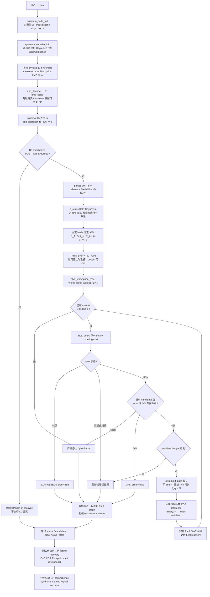

# Quantum LC-GCD：TASK2 完成细节报告

更新日期：2026-11-27（Asia/Shanghai）。本文对照当前 source/header/test，合并 [TASK2 原始验收记录](quantum_task2_.md) 与 [量子早停补充](quantum_early_stopping.md)，作为 TASK2 的完整阅读入口。两份原文保留用于追溯；其中“关闭早停、只有耗尽才能证明”的旧状态，以本文记录的当前实现为准。

当前完成范围是 **posterior SWT → partial SWT → fixed-basis Quantum LC-GCD → single-scale BP-LCGCD → logical success**，并包含严格早停和可选 DAI。开发遵循 [后续开发 Guide](BP_LCGCD_Next_Development_Guide.md)，停在 **PAUSE B**。本次整理只新增报告，没有修改译码算法。

查尺寸与字段可先读 §1～3；矩阵使用范围见 §2.3；算法差异见 §4；soft metric 与搜索见 §6～8；早停证明与 DAI 见 §9；logical success 见 §10；完整流程见 §11；资源、验证与来源见 §12～15。

## 1. 先统一 n、N、m、r、k 的含义

### 1.1 本报告采用的符号

| 符号 | 含义 | 当前代码中的对应值 |
| --- | --- | --- |
| `n` | 物理 qubit 数；一个 Pauli pattern 的长度 | `code->graph.cols`、`code->hx.cols`、`QbpResult.length`、`QuantumDecodeResult.length` |
| `m` | 输入 stabilizer/check 行数，允许有冗余行 | `code->graph.rows`、`code->hx.rows`、`code->hsyn.rows`；实测 syndrome 长度 |
| `r` | 独立 stabilizer 数，即二进制矩阵的秩 | `syndrome_form.rank = stabilizer_form.rank = rank(Hsyn) = rank(S)` |
| `k_q = n-r` | 逻辑 qubit 数；量子码 `[[n,k_q,d]]` 中的 `k` | 没有独立保存为 workspace 字段，可由 `n` 和 `rank` 得到 |
| `N = 2n` | 二进制辛表示 `(EX\|EZ)` 的总长度 | `code->hsyn.cols`、`syndrome_form.reduced.cols` |
| `K_b = N-r` | 给定 syndrome 后，二进制仿射解空间的自由维数 | `quantum_decoder.c` 局部变量 `k = N-rank` |
| `δ` | 放进 local constraints 的固定 basis 分量数，`0 ≤ δ ≤ r` | `QuantumLcgcdConfig.delta`、`trellis.delta` |
| `L = K_b+δ` | Trellis 的阶段数，也是一条 SLVA path 的 bit 数 | `trellis.length`、`workspace.partial.length` |
| `T = 2^δ` | 每层 Trellis 的状态数 | `trellis.state_count` |
| `E_g` | Pauli Tanner graph 非 I entry 数；本文用下标避免与物理错误 `E` 混淆 | `code->graph.edge_count` |
| `C_pool` | 固定 SLVA 存储可以容纳的路径 slot 数 | `list.capacity`、`list.limits.max_candidates` |
| `C_stop` | 严格早停的 Pauli 耦合修正，详见 §9 | 其保守浮点版本包含于 `workspace.stop_correction` |

因此：

\[
K_b=2n-r=n+k_q.
\]

**`K_b` 不是逻辑 qubit 数。** 量子 decoder 复用经典二进制搜索后，代码中的小写 `k` 有时代表 `K_b`；阅读时必须结合矩阵列数理解。若输入含冗余 check，`m` 也不能代替 `r`，所以逻辑维数应写成 `n-r`，只有独立行时才等于 `n-m`。

### 1.2 与已有经典 LC-GCD 变量名的对应

| 代码位置 | 局部变量 | 在量子调用路径中的实际含义 |
| --- | --- | --- |
| `quantum_decoder.c` 初始化/后处理 | `n`、`m`、`N`、`rank`、`k` | 分别是物理 `n`、输入 `m`、`2n`、`r`、`K_b` |
| `local_constraints.c` | `n = form->reduced.cols` | 本报告的 `N=2n`，不是物理 qubit 数 |
| `local_constraints.c` | `m = form->rank`、`rows = form->reduced.rows` | 分别是 `r` 和输入行数 `m` |
| `local_constraints.c` | `k = n-m` | 本报告的 `K_b=N-r` |
| `trellis.c` | `n`、`m`、`k` | 同样分别表示 `N`、`r`、`K_b` |
| 经典 `decoder.c` 的 fixed-basis 内核 | 列数、`form->rank`、列数减秩 | 原来对应经典 `N_c`、`r_c`、`K_c`；量子使用相同线性代数，但最终候选度量不同 |

这些是现有通用模块中的局部命名，本次没有为统一符号而改动生产代码。

### 1.3 5-qubit 示例的实际尺寸

测试使用 stabilizer `{XZZXI, ZZXIX, ZXIXZ, XIXZZ}`，对应 `[[5,1,3]]`：

```text
n=5, m=4, r=4, k_q=1
N=10, K_b=6
δ=2  =>  L=8, T=4

Pauli error / hard / recovery : 5 个 Pauli
prior / posterior XYZ        : 每个分量 5 个 double
binary reference / recovery  : 10 个 uint8_t
measured syndrome           : 4 个 uint8_t
Hsyn / S                    : 4×10
Hsys                        : 4×10
P                           : 4×6
P_A / P_Ac                  : 2×6 / 2×6
SLVA path                   : 8 个 uint8_t
Viterbi table               : (8+1)×4=36 个 ViterbiCell
```

这个例子的每行有 4 个非 I entry，因此 `E_g=16`，QNMS double 消息区是 `5×16+3×5=95` 个 double。若增加一个冗余 stabilizer 行，输入 syndrome 和矩阵行数随 `m` 增长，但只要秩不变，`k_q`、`K_b`、`L`、`T` 都不变。

## 2. 哪些是 H，哪些是 Hsys，哪些是 S

### 2.1 原始 Pauli 与二进制坐标

忽略整体 Pauli phase，单个 qubit 的编码为：

| Pauli | X component | Z component | C enum 值 |
| --- | ---: | ---: | ---: |
| I | 0 | 0 | `PAULI_I=0` |
| X | 1 | 0 | `PAULI_X=1` |
| Y | 1 | 1 | `PAULI_Y=2` |
| Z | 0 | 1 | `PAULI_Z=3` |

binary vector 一律采用 **先全部 X、再全部 Z**：

\[
e=(E_X[0:n]\mid E_Z[0:n])\in\mathrm{GF}(2)^N.
\]

不是逐 qubit 的交错存储。C enum 的整数值也不能直接拆成这两个 bit。实现使用 `x={0,1,1,0}`、`z={0,0,1,1}`，反向用 `labels[2*x+z]={I,Z,X,Y}`。

### 2.2 矩阵及用途总表

| 对象 | 尺寸 | 坐标/作用 | 实际存放位置 |
| --- | --- | --- | --- |
| `Hx` | `m×n` | stabilizer 每个 Pauli 的 X component | `QuantumCode.hx` |
| `Hz` | `m×n` | stabilizer 每个 Pauli 的 Z component | `QuantumCode.hz` |
| `S=[Hx\|Hz]` | `m×N` | stabilizer 自身的 binary 表示；定义 stabilizer row space | 初始化时临时拼接；长期保留 `stabilizer_form` |
| `Hsyn=[Hz\|Hx]` | `m×N` | 对原始 `(EX\|EZ)` 做普通 GF(2) 乘法得到 syndrome | `QuantumCode.hsyn` |
| `U_H` | `m×m` | 对 `Hsyn` 做离线行变换，也必须同样作用于 RHS | `syndrome_form.row_transform` |
| `U_H Hsyn Q_H` | `m×N` | 上 `r` 行 `[I_r\|P]`，下 `m-r` 行为零 | `syndrome_form.reduced` |
| `Hsys=[I_r\|P]` | `r×N` | 原始 syndrome 方程经行变换和列置换后的独立方程 | `syndrome_form.reduced` 的前 `r` 行，并无额外 `Hsys` 字段 |
| `P` | `r×K_b` | 固定 basis 与 free columns 之间的重编码关系 | `syndrome_form.reduced` 的前 `r` 行、后 `K_b` 列 |
| `P_A` / `P_Ac` | `δ×K_b` / `(r-δ)×K_b` | 当前帧按 basis reliability 选出的 P 行 | `local.p_a` / `local.p_ac` |
| `M_local=[I_δ\|P_A]` | `δ×L` | local syndrome 约束 | 逻辑矩阵，由 `trellis.column_masks` 按列打包，不单独申请 dense 对象 |
| `U_S S Q_S` | `m×N` | stabilizer row-space 的系统形式，上部 `[I_r\|P_S]` | `stabilizer_form.reduced` |

量子论文有时用 `H=(Hx|Hz)` 表示 stabilizer parity-check matrix；本项目为复用普通 GF(2) 乘法，另起名 `Hsyn=(Hz|Hx)`。阅读论文中的 `H` 时，应先判断它使用辛内积还是普通矩阵乘法。

对列向量形式：

\[
s=H_{\rm syn}e=H_ZE_X+H_XE_Z.
\]

stabilizer 合法性要求：

\[
H_XH_Z^T+H_ZH_X^T=0,
\]

于是 `Hsyn*S^T=0`。这解释了为什么 stabilizer 差异不改变 syndrome。`S` 与 `Hsyn` 只是交换列块，秩相同，但在固定 `(EX|EZ)` 坐标下具有不同含义。

### 2.3 模块到底使用哪个矩阵

| 阶段/函数 | 使用对象 | 不可混淆的点 |
| --- | --- | --- |
| `quantum_code_init` | 原始 `Hx/Hz` | 检查对易性，构造原始 Pauli graph 和 `Hsyn` |
| `qbp_decode` | 原始 **Pauli stabilizer graph** | 节点是 `m` 个原始 check、`n` 个 qubit；不在 `Hsys` 上跑 BP |
| `quantum_code_syndrome` | 原始 Pauli graph | 逐 entry 计算 anticommute parity，数学上等价于 `Hsyn*e` |
| `postprocess` 的 reference residual | 原始 `Hsyn` | `s_res = measured XOR Hsyn*b`，长度 `m` |
| `local_constraints_prepare` | `syndrome_form`，即 `Hsyn` 的系统形式 | 先用 `U_H` 变换 residual，再取 `Hsys/P` 的行；不能只重排列而忘记 RHS 行变换 |
| `syndrome_trellis_prepare`、Viterbi/SLVA | 从 `Hsys` 提取的 local constraints | 枚举 `(f_A,f_free)`，没有再次消元 |
| 完整 binary candidate 重建 | `P_Ac` 和 `Q_H` 对应的列映射 | 先恢复系统坐标的 flip，再回原始坐标并 XOR reference |
| 最终候选 syndrome 复核 | 原始 Pauli graph | 与原始 measured syndrome 比较，不拿 local syndrome 代替真实 syndrome |
| `quantum_recovery_check` | 原始 graph + **`stabilizer_form`** | 先看 residual syndrome，再检查 `rowspan(S)`；不能用 `rowspan(Hsyn)` 代替 |

### 2.4 原始坐标与系统坐标

对 `syndrome_form`：

```text
v_sys[j]  = v_orig[sys_to_orig[j]]
v_orig[c] = v_sys[orig_to_sys[c]]

sys j < r : fixed basis component
sys j ≥ r : fixed free component
```

`sys_to_orig` 保存的是 **0..N-1 的 binary column index**，不是 0..n-1 的 qubit index。只有要投影回 qubit 时才使用 `column % n`。

`stabilizer_form` 有自己的一套 `sys_to_orig/orig_to_sys`。即使两矩阵的秩和尺寸相同，也不能把两套映射互换。

## 3. 结构体字段长度与内存归属

下表中的长度是**元素数**。`BitVector.data` 与 `BinaryMatrix.data` 当前均为 `uint8_t`，一个 GF(2) bit 占一个 byte，没有按位压缩；`Pauli[]` 占用 `长度*sizeof(Pauli)`，不假设 enum 只有一个 byte。消息和 soft weight 使用 `double`，下界修正使用 `long double`。

### 3.1 基础 GF(2) 与离线系统形式

对应 [gf2.h](../include/bplcgcd/gf2.h)。

| 结构体/字段 | 长度或尺寸 | 说明 |
| --- | --- | --- |
| `BinaryMatrix.rows/cols` | 各一个 `size_t` | 当前对象自己的行列数，不能仅凭类型认定是 `n/m` |
| `BinaryMatrix.data` | `rows*cols` 个 `uint8_t` | row-major：`data[i*cols+j]` |
| `BitVector.length` | 一个 `size_t` | 当前向量长度 |
| `BitVector.data` | `length` 个 `uint8_t` | 具体意义由持有它的字段决定 |
| `BinarySystematic.rank` | 一个 `size_t`，值为 `r` | `Hsyn` 和 `S` 的 form 都有该字段 |
| `BinarySystematic.reduced` | `m×N` | 保留全部输入行；只有前 `r` 行叫 `Hsys` |
| `BinarySystematic.row_transform` | `m×m` | 完整行 XOR 变换，不只是 row permutation |
| `BinarySystematic.sys_to_orig` | `N` 个 `size_t` | system column → original binary column |
| `BinarySystematic.orig_to_sys` | `N` 个 `size_t` | 上一映射的逆 |

`BinarySystematic` 拥有这些内存。`QuantumDecoderWorkspace` 内有两个独立实例，分别来自 `Hsyn` 和 `S`。

### 3.2 QuantumCode 与 sparse Pauli graph

对应 [quantum.h](../include/bplcgcd/quantum.h)。

| 结构体/字段 | 长度或取值范围 | 说明 |
| --- | --- | --- |
| `QuantumCode.hx/hz` | 各 `m×n` | 拷贝输入，供 code 生命周期使用 |
| `QuantumCode.hsyn` | `m×N` | 原始二进制 syndrome 矩阵 |
| `QuantumCode.graph` | 一个 `QbpGraph` | 原始 Pauli stabilizer 的稀疏拓扑 |
| `QbpGraph.rows/cols/edge_count` | `m/n/E_g` | 原始行、qubit 列、非 I entry 数 |
| `QbpGraph.row_header` | `m` 个 `QbpEdge` | circular row sentinels，沿 `right` 遍历 |
| `QbpGraph.col_header` | `n` 个 `QbpEdge` | circular column sentinels，沿 `down` 遍历 |
| `QbpGraph.edges` | `E_g` 个 `QbpEdge` | 一个非 I entry 一条 edge，Y 也是一条 |
| `QbpEdge.row/col/edge_index` | 分别落在 `[0,m)`、`[0,n)`、`[0,E_g)` | `edge_index` 索引独立消息数组 |
| `QbpEdge.pauli` | X/Y/Z 之一 | 这是 stabilizer 在该位置的 Pauli label |
| `QbpEdge.left/right/up/down` | 各一个指针 | 拓扑链接，没有隐藏的消息数组 |

`QuantumCode` 拥有矩阵和拓扑；构造后只读，多个独立 decoder workspace 可以共享同一个 code。

`E_g` 按 Pauli entry 计数，不是 `nnz(Hsyn)`。若 X/Y/Z entry 数分别为 `e_X/e_Y/e_Z`，则 `E_g=e_X+e_Y+e_Z`，但 `nnz(Hsyn)=e_X+2e_Y+e_Z`。这也是不能把 BP 的 qubit columns/edge messages 直接按 Hsyn 的二进制非零项分配的原因。

### 3.3 信道、QNMS 输入、workspace、结果

对应 [quantum_channel.h](../include/bplcgcd/quantum_channel.h)、[qbp.h](../include/bplcgcd/qbp.h)。

| 结构体/字段 | 长度或含义 | 归属/坐标 |
| --- | --- | --- |
| `PauliProbabilities.p_i/p_x/p_y/p_z` | 4 个概率标量 | 一个 qubit 的物理 Pauli 分布；`p_i` 的 i 是 Identity |
| `QbpPrior.length` | `n` | 不使用 `N=2n` |
| `QbpPrior.prior_x/prior_y/prior_z` | 各 `n` 个 `double` | caller-owned，原始 qubit 顺序；每个值是相对 I 的 prior LLR |
| `QbpConfig.max_iterations` | 正整数 | BP 最大迭代次数 |
| `QbpConfig.nms_scale` | 标量，`0<scale≤1` | check update 直接乘该值 |
| `QbpConfig.message_clip` | 非负有限标量 | 仅 degree-one check 的数值替代值；0 选择 50，详见 §5 |
| `QbpWorkspace.code` | 一个 borrowed pointer | code 必须比 workspace 活得久 |
| `QbpWorkspace.messages` | `5E_g+3n` 个 `double` | 单块 owning storage，以下 double 指针均为其切片 |
| `v2c_x/v2c_y/v2c_z` | 各 `E_g` | 每条 edge 的三元 extrinsic message |
| `c2v` | `E_g` | 每条 edge 一个 scalar check message |
| `commutation` | `E_g` | V2C 三元压缩后的 commute/anticommute LLR scratch |
| `post_x/post_y/post_z` | 各 `n` | 每个 qubit 的 posterior XYZ LLR |
| `hard_estimate` | `n` 个 `Pauli` | Pauli hard decision |
| `syndrome` | `m` 个 `uint8_t` | 当前 hard estimate 的原始 syndrome |
| `QbpResult.length` | `n` | 与 prior 的 qubit 数一致 |
| `QbpResult.iterations_used` | 一个计数 | 本次实际完成的 BP 迭代次数 |
| `QbpResult.syndrome_matched` | 一个 int flag | 只表示 BP hard 与 measured 匹配 |
| `QbpResult.hard_estimate/post_x/post_y/post_z` | `n/n/n/n` | borrowed views，指向 `QbpWorkspace` |

消息区偏移按 double 元素计数：

```text
v2c_x=0, v2c_y=E_g, v2c_z=2E_g, c2v=3E_g, commutation=4E_g
post_x=5E_g, post_y=5E_g+n, post_z=5E_g+2n
```

`QbpResult` 不负责释放数据，下次同 workspace 的 decode/free 后旧 view 不再代表本帧。

### 3.4 SWT 与 QuantumLcgcdConfig

对应 [quantum_decoder.h](../include/bplcgcd/quantum_decoder.h)。

| 结构体/字段 | 长度或含义 |
| --- | --- |
| 一个 `PauliSwt.w` | 固定 4 个 double，按 enum 的 I/X/Y/Z 顺序；最小值为 0 |
| `workspace.swt` | `n` 个 `PauliSwt`，总计 `4n` 个 double |
| 一个 `PartialSwt.x/z` | 各固定 2 个 double，对应 component=0/1 |
| `workspace.partial_swt` | `n` 个 `PartialSwt`，总计 `4n` 个 double |
| `QuantumLcgcdConfig.delta` | `δ`，初始化时固定 |
| `candidate_limit` | 最多评估的完整 Pauli candidate 数；0=不限 |
| `state_limit` | Trellis 状态预算；0 使用 4096 |
| `slva_max_candidates` | 活跃 heap/pending/临时路径的资源上限；0 使用 65536 |
| `slva_max_bytes` | SLVA 分配 payload 预算；0 使用 64 MiB |
| `post_policy` | 默认 `BP_POST_ON_FAILURE`；另有 `BP_POST_ALWAYS` |
| `stop_policy` | 默认 `QUANTUM_STOP_TRIVIAL`；另有 `QUANTUM_STOP_DISABLED/DAI` |

`candidate_limit` 与 `slva_max_candidates` 是两种不同限制：前者计已经完整评分的候选，后者限制搜索器存储。资源上限也不等于 `2^K_b` 的搜索空间大小。

### 3.5 QuantumDecoderWorkspace：逐字段尺寸

所有 binary 坐标除特别说明外均为原始 `(X|Z)` 顺序。

| 字段 | 元素数/尺寸 | 内容 |
| --- | --- | --- |
| `code` | 一个 borrowed pointer | 原始 code，不复制拓扑 |
| `config` | 一个配置副本 | 初始化时拷贝 |
| `syndrome_form` | §3.1 的一个实例 | `Hsyn` 的离线系统形式，搜索使用 |
| `stabilizer_form` | §3.1 的一个实例 | `S` 的离线系统形式，logical check 使用 |
| `bp` | §3.3 的一个实例 | 独立 QNMS workspace |
| `swt` / `partial_swt` | 各 `n` 个 tuple | 完整 Pauli soft weights / binary marginal weights |
| `reliability` | `N` 个 double | 前 `n` 个为 X reliability，后 `n` 个为 Z reliability |
| `candidate` | `n` 个 Pauli | 搜索时当前完整候选；logical check 时暂存 residual Pauli |
| `recovery` | `n` 个 Pauli | 当前最佳完整候选；logical check 不覆盖它 |
| `reference` | `N` 个 uint8_t | binary marginal hard `b`，不是必然等于 BP 的 Pauli hard binary 化结果 |
| `residual` | `m` 个 uint8_t | `s_res=measured XOR Hsyn*b` |
| `transformed` | `m` 个 uint8_t | `U_H*s_res`，保留冗余行部分以做一致性检查 |
| `system` | `N` 个 uint8_t | 系统坐标中的完整 **flip** `f_sys`，尚未 XOR reference |
| `partial` | `L` 个 uint8_t | SLVA 输出 path `(f_A,f_free)`；不是 `PartialSwt` |
| `binary` | `N` 个 uint8_t | 复用 scratch，分阶段语义见下表 |
| `syndrome` | `m` 个 uint8_t | 最佳 recovery 或 logical residual 的原始 syndrome scratch |
| `local_rhs` | `r` 个 uint8_t | local RHS 的 backing storage，分成 `s_a/s_ac` |
| `local` | 一个 `LocalConstraints` | 见 §3.6，内部部分字段是上述 buffer 的 view |
| `local_p` | `r*K_b` 个 uint8_t | `p_a/p_ac` 的共享 backing storage |
| `trellis` | 一个 `SyndromeTrellis` | 见 §3.7；stage mapping 每帧更新，存储复用 |
| `list` | 一个 pooled `SlvaGenerator` | 见 §3.8；prefix table、heap、paths 预分配 |
| `stop_correction` | 一个 long double | `C_stop` 加浮点累计误差的保守上界 |
| `dai_threshold` | 一个 double | 当前帧 DAI 的 `τ`；严格模式为 0 |

| `binary` 的使用阶段 | 此时内容 |
| --- | --- |
| `prepare_stopping` | searched set `M=A∪free` 的 N 位 membership mask |
| 每次完整候选重建 | 原始坐标 recovery binary bits `b XOR f` |
| `quantum_recovery_check` | 原始坐标 residual bits `physical XOR recovery` |

这些复用值不能跨阶段当成持久结果。特别是 measured syndrome 来自调用方输入，`workspace.syndrome` 不长期保存它；稳定输出应读 `result.recovery`。

### 3.6 LocalConstraints

对应 [local_constraints.h](../include/bplcgcd/local_constraints.h)。该模块注释里的 basis 长度 `m` 指其局部变量 `form->rank`，也就是本报告的 `r`。

| 字段 | 长度或尺寸 | 坐标/内容 |
| --- | --- | --- |
| `basis_order` | `r` 个 size_t | 原始 binary column indices；前 δ 为 A，后 r-δ 为 Ac |
| `p_a` | `δ×K_b` | P 的 A 行，列仍是系统 free 顺序 |
| `p_ac` | `(r-δ)×K_b` | P 的 Ac 行，同一 free 顺序 |
| `s_a` | `δ` | transformed syndrome 的 A 行 |
| `s_ac` | `r-δ` | transformed syndrome 的 Ac 行 |

只对**离线固定 basis 的 r 个分量**按 reliability 降序选 A；相同 reliability 按原始列索引升序。即使某个 free column 更可靠，也不会换入 basis，因此没有在线 GE。`p_a/p_ac` 和 `s_a/s_ac` 是 backing storage 的切片，不分别 free。

### 3.7 SyndromeTrellis 与 ViterbiCell

对应 [trellis.h](../include/bplcgcd/trellis.h)、[viterbi.h](../include/bplcgcd/viterbi.h)。

| 字段 | 长度或范围 | 含义 |
| --- | --- | --- |
| `SyndromeTrellis.length` | `L=δ+K_b` | stage 数，不是 `n` 或 `N` |
| `delta` / `state_count` | `δ` / `T=2^δ` | 状态是 δ 位局部 syndrome |
| `target` | 一个 size_t，`0≤target<T` | 将 `s_a[i]` 打包到第 i bit |
| `column_masks` | `L` 个 size_t | `M_local` 每一列的 δ-bit mask |
| `original_columns` | `L` 个 size_t | stage → 原始 binary column；前 δ 项来自 A，之后 K_b 项来自固定 free columns |
| `flip_weights` | borrowed `N` 个 double | 指向整个 `workspace.reliability`；使用 `original_columns[stage]` 索引，不能当成只有 L 项的 stage-weight 数组 |
| `ViterbiCell.metric` | 一个 double | 到该 layer/state 的最小 binary ordering cost |
| `ViterbiCell.previous_state` | 一个 size_t | 前驱 state；不可达时 `SIZE_MAX` |
| `ViterbiCell.bit` | 一个 uint8_t | 到达该 cell 采用的 0/1 标签 |
| `list.cells` | `(L+1)*T` 个 cell | `cells[layer*T+state]`，含初始层 |

转移为 `q_next=q XOR (bit ? column_masks[stage] : 0)`；代价为 `bit*reliability[original_columns[stage]]`。相同起终状态的 0/1 平行边仍是两条不同 bit path。

### 3.8 SlvaCandidate、SlvaLimits、SlvaGenerator

对应 [slva.h](../include/bplcgcd/slva.h)。

| 字段 | 长度或含义 |
| --- | --- |
| `SlvaCandidate.bits` | 一条 L-byte path；pool 的 slot stride 为 `max(L,1)` |
| `SlvaCandidate.free_length` | 0..L；此候选组中可变前缀的长度，后缀 `[free_length,L)` 固定；不是 `K_b` |
| `SlvaCandidate.cost` | 该组最轻代表的 binary ordering cost，不是完整 Pauli cost |
| `SlvaCandidate.sequence` | 稳定排序用的创建序号 |
| `SlvaLimits.max_candidates/max_bytes` | 活跃路径 slot 上限 / allocation payload 上限，均为正 |
| `SlvaLimits.path_limit` | 最多输出 paths；0=不限。量子 wrapper 使用 0，由外层 `candidate_limit` 计完整候选 |
| `SlvaGenerator.trellis` | borrowed Trellis pointer |
| `cells/cell_capacity` | Viterbi 表 / 预留 cell 元素数，本实例为 `(L+1)*T` |
| `heap` | `capacity=C_pool` 个 SlvaCandidate 的预留区 |
| `size/capacity` | 活跃堆元素数 / 堆容量，不是 frame candidates_evaluated |
| `pending` | 一个已输出、尚待按分组规则展开的候选 |
| `limits/bytes_used` | 配置 / 固定模式下全部预留 payload 字节数 |
| `paths_returned` | `slva_next` 成功输出的路径数 |
| `next_sequence` | 候选组创建序号的下一值 |
| `nodes_expanded` | 成功完成子组拆分的输出组计数 |
| `path_pool` | `C_pool*max(L,1)` 个 uint8_t |
| `free_slots` | `C_pool` 个 size_t，保存可复用 slot index |
| `path_stride` | `max(L,1)`，以 byte 计 |
| `free_count` | 当前空闲 slot 个数 |

SLVA 的原动态入口 `slva_init` 仍存在，`path_pool=NULL` 时使用旧存储方式。量子路径固定使用 `slva_workspace_init/reset`，但两者共享 Viterbi、分组、heap、peek/next 算法。

### 3.9 结果与统计字段

| 结构体/字段 | 长度或语义 |
| --- | --- |
| `QuantumDecodeResult.length/recovery` | `n` / borrowed `n` 个 Pauli |
| `cost` | 当前最佳 recovery 的完整 posterior Pauli SWT 总和 |
| `status` | API/搜索状态；`DECODE_SUCCESS` 不代表 logical success，也不自动代表最优 |
| `candidate_valid` | 有可用、满足实测 syndrome 的完整候选 |
| `syndrome_matched` | 该 recovery 与 measured syndrome 一致 |
| `optimality_proven` | 本次搜索由严格 Pauli bound 或耗尽得到最优性证明 |
| `postprocess_invoked` | 本帧是否执行 LC 后处理 |
| `posterior` | 一个 QbpResult view；其数组仍各长 n |
| `stats` | 一个 DecoderStats，全部是计数标量 |
| `stop_reason` | 共用的 BOUND/EXHAUSTED/BUDGET/RESOURCE/NONE |
| `early_stop` | 本次实际命中的 NONE/TRIVIAL/DAI，不只是配置值 |
| `remaining_lower_bound` | 最近一次检查的未搜索部分保守 Pauli 下界 |
| `dai_threshold` | 当前使用的 τ |
| `QuantumRecoveryCheck.syndrome_matched/logical_success` | 两个 bool；与译码结果分开，只有测试/仿真层掌握真实 physical error 后才能计算 |

`DecoderStats` 的 `candidates_popped/evaluated` 分别计输出及完整评分的候选；`nodes_expanded` 来自 SLVA；`partial_patterns_generated` 来自创建的组；`trellis_states_visited` 计前向表中初始层到第 L-1 层的有限状态展开；当前量子路径不使用 batch 搜索，`batches` 保持 0。这些计数均不是长度字段。

`result.recovery` 借用到下次 decode/free。BP wrapper 的 `result.posterior` 指向 `workspace.bp`；独立 `quantum_lcgcd_decode` 的 posterior view 仍引用调用方提供的数组。logical check 可以覆盖 scratch，但不会覆盖最佳 recovery 或 BP posterior。

### 3.10 与经典 DecodeInput/DecodeResult 的区别

经典 [decoder.h](../include/bplcgcd/decoder.h) 的 `DecodeInput.h` 指向原始 binary H，`systematic` 才指向它的 offline form；`length`、`llr/weights`、`z_hint` 和 `DecodeResult.estimate` 按 H 的列数计，`s_target` 按 H 的原始行数计。`h` 不是 Hsys。

当前量子入口没有把 posterior 塞进这个独立 binary-cost API；它使用 `QuantumDecoderWorkspace` 和 `QuantumDecodeResult`，只复用下层线性约束及搜索模块，并共用状态/计数类型。因此不能把 `QuantumDecodeResult.length=n` 与经典 binary result 的长度直接类比，也不能直接用经典 `DecodeResult.cost` 的解释替代 Pauli cost。

## 4. 量子 QLDPC 与经典 LDPC/LC-GCD 的关键差异

| 项目 | 已有经典路径 | 当前量子路径 |
| --- | --- | --- |
| 物理变量 | 一个位置一个 binary symbol | 一个 qubit 四个 Pauli 状态 I/X/Y/Z |
| 搜索表示 | 长度 N_c 的 binary vector | Pauli 长 n，binary 辛表示长 N=2n |
| check 的数学作用 | 普通 GF(2) parity | Pauli commute/anticommute parity；binary 下由 `[Hz\|Hx]` 计算 |
| BP 软信息 | 每 bit 一个 LLR | 每 qubit 相对 I 的 X/Y/Z 三元 LLR |
| BP edge | 一个 binary 非零 entry | 一个非 I Pauli entry；Y 保留为一条有 label 的 edge |
| BP check 消息 | 二元 check scalar | 从 XYZ 压缩出 commutation LLR，再进行 scalar NMS |
| reliability | signed LLR 的绝对值可用于独立 binary flip metric | 先由四态 SWT 边缘化到 X/Z，再取分量差；两分量存在联合约束 |
| reference | 经典 hard decision，搜索最小 flip weight | binary marginal hard，可能与 Pauli MAP hard 不同，且未必满足实测 syndrome |
| 完整候选代价 | 既定 reference 下的 binary flip cost 总和 | `sum_i w_i[Pauli_i]`，Y 用自己的 posterior weight |
| partial 与 full cost | 非负被省略项通常直接给出下界 | marginal ordering cost 一般不是 Pauli 下界；当前先做 §9 修正 |
| 线性代数 | 普通 H 的固定系统形式 | 搜索用 Hsyn 的固定系统形式；logical check 另用 S 的系统形式 |
| 成功标准 | 与发送码字相同，统计 BER/FER | recovery 与 physical error 相差 stabilizer 即成功；syndrome 相同仍可能 logical fail |
| 统计横轴 | 现有 BPSK/AWGN 的 Eb/N0 | 当前 depolarizing 的物理 Pauli error rate p |
| 最优性范围 | 给定经典度量的候选最小值 | 给定 posterior SWT 的 **Pauli pattern** 最小值；不是按 stabilizer coset 累加概率后的 degenerate ML |

量子路径直接复用经典 GF(2)、固定 basis、local constraints、Trellis/Viterbi/SLVA 和 Ac 重编码。需要单独实现的是 Pauli soft information、完整评分、与排序相配的下界、logical equivalence。将量子问题转成 2n 个 binary 线性变量，只解决了约束表达，不能据此把 X/Z 概率也当成互相独立。

## 5. 物理信道与 QNMS：TASK2 的前端

### 5.1 信道 prior 与 BP posterior

物理信道给出 `pI/pX/pY/pZ`，构造：

\[
\Lambda_i^P=\log\frac{p_i^I}{p_i^P},\qquad P\in\{X,Y,Z\}.
\]

depolarizing 使用 `pI=1-p`、`pX=pY=pZ=p/3`。信道层负责概率和采样；QNMS 输入的是 caller 提供的三元 prior 数组，不在 kernel 内根据 p 重新生成 prior。

BP 输出 `muX/muY/muZ`，代表利用 graph 和 measured syndrome 更新后的 soft information。BP-LCGCD 后处理使用本次 posterior；如果跳过 BP 而向独立 LC 接口提供 channel prior，算法应明确称为 prior-based Quantum LC-GCD。

### 5.2 Quantum NMS 的一轮

每条 edge 的三元 V2C 初始为该 qubit 的 prior。对 edge stabilizer `P`，其余两种非 I Pauli 记为 `Q,R`：

\[
\lambda_{i\to j}=\log\frac{1+e^{-\mu_{i\to j}^P}}
{e^{-\mu_{i\to j}^Q}+e^{-\mu_{i\to j}^R}}.
\]

分子是 commute 的 `{I,P}` 概率质量，分母是 anticommute 的 `{Q,R}` 概率质量。`qbp_commutation_llr` 使用稳定 log-sum-exp。check update 为：

\[
m_{j\to i}=(-1)^{s_j}\,\texttt{nms_scale}
\prod_{i'\ne i}\operatorname{sgn}(\lambda_{i'\to j})
\min_{i'\ne i}|\lambda_{i'\to j}|.
\]

每行两次遍历，使用 sign parity、min1/min2 和最小值 edge index，使整轮稀疏更新随 `E_g` 线性增长。随后：

\[
\mu_i^P=\Lambda_i^P+
\sum_{j:\langle P,S_{j,i}\rangle=1}m_{j\to i}.
\]

对 `(0,muX,muY,muZ)` 取最小值得 Pauli hard；ties 按 I/X/Y/Z 顺序。若尚未停止，再从 posterior 中减掉本 edge 的 anticommute 项，得到下一轮 extrinsic V2C。采用 flooding：完成所有 check 更新后，再做所有 posterior/variable 更新。

`nms_scale` 直接乘在最小值上。2025 论文的 `alpha=1.6` 对应本工程 `nms_scale=0.625`。

### 5.3 BP 早停与 message_clip

每轮 Pauli hard 后计算**原始 quantum syndrome**；匹配 measured 即结束 BP，或到达 max_iterations 后输出未收敛 posterior。迭代耗尽仍可返回 `QUANTUM_OK`，是否收敛读 `QbpResult.syndrome_matched`。这个 BP 早停只说明 hard estimate 满足 syndrome，不判断 logical success。

普通 degree≥2 check 的 `min1/min2` 从 `INFINITY` 开始，按实际 `min|lambda|` 计算，**不使用默认 50 饱和，也不使用 message_clip 截断普通消息**。

degree-one check 的 outgoing minimum 是 `min(empty)=+infinity`，单独使用局部数值政策：将这个空集最小值替换为有限正数 `message_clip`，配置为 0 时用 50，再乘 nms_scale，符号由 measured syndrome 决定。它没有改变其他 check 的 QNMS 公式。

## 6. Posterior → Pauli SWT → partial SWT

实现位于 [quantum_soft.c](../src/decoders/quantum_soft.c)。以下 log 均为自然对数。

### 6.1 完整 SWT 与 posterior LLR 的等价变换

设 BP 的单 qubit posterior 为 `q_i(P)`，且：

\[
\mu_i^P=\log\frac{q_i(I)}{q_i(P)}.
\]

先取 `a_i=(0,muX,muY,muZ)`，令 `c_i=min_P a_i(P)`，再构造：

\[
w_i(P)=a_i(P)-c_i
=\log\frac{\max_Q q_i(Q)}{q_i(P)}\ge0.
\]

`qbp_posterior_to_swt` 不显式恢复归一化概率；它保留所有 Pauli pair 的 weight difference，最可信 Pauli 的 weight 为 0。与 `-log q_i(P)` 相比，每个 qubit 同减常数，完整候选排序不变。这对应 2024 的 SWT 表示及 2025 Eq. (21)。

### 6.2 Partial SWT 是边缘化，不是拆开 Y 的 cost

定义：

\[
a\boxplus b=-\log(e^{-a}+e^{-b}).
\]

实现以 `min(a,b)-log1p(exp(min(a,b)-max(a,b)))` 计算，避免不必要的指数溢出。按照 2024 Eq. (13)～(15)：

\[
\begin{aligned}
w_i^X(0)&=w_i(I)\boxplus w_i(Z),&
w_i^X(1)&=w_i(X)\boxplus w_i(Y),\\
w_i^Z(0)&=w_i(I)\boxplus w_i(X),&
w_i^Z(1)&=w_i(Z)\boxplus w_i(Y).
\end{aligned}
\]

然后：

\[
b_i^X=[w_i^X(1)<w_i^X(0)],\quad
\rho_i^X=|w_i^X(1)-w_i^X(0)|,
\]

Z 同理。报告用 `ρ` 表示 reliability，避免与矩阵秩 `r` 混淆。ties 时 binary hard 为 0。`reference=(bX|bZ)` 长 N，`reliability=(ρX|ρZ)` 同样长 N。

由于输入 SWT 只有相对归一化，`exp(-w)` 的总和不必为 1，partial weights 可以为负；这不影响 marginal 的概率比，reliability 仍非负。

**Pauli hard 与 marginal hard 是两个对象。** 例如 posterior `(I,X,Y,Z)=(.4,.3,.25,.05)` 的最可信 Pauli 为 I，但 X marginal 的 1 概率为 `.3+.25=.55`，因此 binary marginal hard 为 `(1,0)`，对应 X。不能用这个 binary reference 替代 BP hard 的 syndrome convergence 判定。

### 6.3 完整评分必须返回 Pauli 空间

每个完整候选 `Q[0:n]` 统一评分：

\[
W(Q)=\sum_{i=0}^{n-1}w_i(Q_i).
\]

`pauli_cost` 对 n 个 tuple 各查一次 Pauli label。`ordering_cost` 仅组织 binary path 的搜索次序，不参与替代最终 cost。尤其 `Q_i=Y` 时直接使用 `w_i(Y)`。

反例：posterior 为 `(.5,.05,.4,.05)` 时，Pauli hard 与两个 marginal hard 都是 I，但：

\[
w(Y)=\log(.5/.4)\approx .223144,
\]

\[
\rho^X+\rho^Z=2\log(.55/.45)\approx .401341.
\]

两次 marginal flip 的和大于 Y 的完整 Pauli cost。因此它既不是 Y 的正确评分，也不能不经修正地作为完整候选下界。

另外，BP posterior 及其逐 qubit SWT 给出了本实现采用的评分模型；即使完整搜索得到此度量最优，也不等于求出了真实噪声条件下所有 qubit 的精确联合 posterior。

## 7. Offline 初始化：只在 code/workspace 建立时消元

主要实现位于 [quantum_decoder.c](../src/decoders/quantum_decoder.c)。

1. `quantum_code_init(Hx,Hz)` 拷贝两块 `m×n` 输入，验证 stabilizer 对易性，构造 Pauli graph 和原始 `Hsyn`。该函数本身不负责系统化。
2. `quantum_decoder_init` 对 `Hsyn` 调用一次 `binary_matrix_systematize`，保留 `syndrome_form`、rank 和双向 column mapping。
3. 临时拼接 `S=[Hx|Hz]`，对 S 再做一次系统化，保留 `stabilizer_form`，随后释放临时 S。两次离线系统化服务不同用途。
4. 检查 `δ≤r`、`T=2^δ` 和资源预算，确定固定 `K_b/L/T`。
5. 分配 §3 的所有 SWT、reference、候选、syndrome/local scratch、stage mappings。
6. `slva_workspace_init(L,T,limits)` 一次性预留 Viterbi 表、heap、path pool、free-slot 表。
7. `qbp_workspace_init` 分配 QNMS 消息、hard 和 syndrome 存储。

随后 code 和两份系统形式保持不变。每帧更新的是消息、soft information、A/Ac 的选择和 RHS，不重建 graph、不改变 fixed basis、不做 GE。

constructor 已保证拓扑和尺寸 invariant，hot loop 不逐 edge/逐 candidate 重做同样检查。公开入口的维度、数值与资源检查仍保留。

## 8. 一帧 Quantum LC-GCD 的数学与数据流程

### 8.1 两个入口及 BP 返回策略

| 入口/策略 | 行为 |
| --- | --- |
| `quantum_lcgcd_decode(workspace, posterior, measured, result)` | 对 caller 提供的 QbpResult 做 LC 后处理；即使该 posterior 的 BP hard 未收敛也可使用 |
| `quantum_bp_lcgcd_decode(workspace, bp_config, prior, measured, result)` | 本帧运行一次指定 scale 的 QNMS，固定使用这次 posterior |
| `BP_POST_ON_FAILURE`，默认 | BP syndrome 匹配则复制 Pauli hard 并直接返回，否则进入 LC |
| `BP_POST_ALWAYS` | 即使 BP syndrome 匹配也进入 LC，供策略对照 |

BP 直接返回时，`candidate_valid=true`、`syndrome_matched=true`、`postprocess_invoked=false`，没有 LC candidates；API 保持 `optimality_proven=false`、`early_stop=NONE`。这个 flag 记录本次搜索是否给出证明，不能根据 BP 收敛自行改写。

### 8.2 建立 residual 方程

由 posterior 计算 §6 的 `swt[n]`、`partial_swt[n]`、`reference b[N]` 和 `reliability[N]`。待求 recovery 的 binary 表示记作 `q`，写为：

\[
q=b\oplus f.
\]

实测 syndrome `s` 来自 physical error，通常不能由 marginal reference 推定。约束为：

\[
H_{\rm syn}q=s
\iff H_{\rm syn}f=s\oplus H_{\rm syn}b=s_{\rm res}.
\]

`residual` 保存长度 m 的 `s_res`。不能像某些经典 all-zero codeword 推导那样，不检查约束就把 reference 当成初始可行 best；本实现从首个经完整约束重建的 Pauli candidate 建立 best。

### 8.3 变换 syndrome 并选 A/Ac

使用 offline 的 `U_H`：

\[
\widetilde s=U_Hs_{\rm res},\qquad
H_{\rm sys}f_{\rm sys}=\widetilde s[0:r].
\]

`transformed` 仍长 m，下方 `m-r` 项必须为 0；否则给出的 syndrome 与冗余行关系不一致，返回 `DECODE_INCONSISTENT_SYNDROME`。

`local_constraints_prepare` 对固定 basis 的 r 个**原始 binary columns**按 reliability 排序，前 δ 项为 A，其他为 Ac；free columns 保持离线顺序。提取：

\[
f_A\oplus P_Af_{\rm free}=s_A,\tag{local}
\]

\[
f_{A^c}\oplus P_{A^c}f_{\rm free}=s_{A^c}.\tag{re-encode}
\]

对应尺寸分别为 `δ`、`r-δ` 个方程。它们是已有 LC-GCD Eq. (9)/(10) 的同一线性关系，只是输入矩阵来自 Hsyn。

### 8.4 Trellis 与 SLVA 枚举什么

Trellis stage 顺序固定为：

```text
path[0:δ]   = f_A，顺序为 local.basis_order[0:δ]
path[δ:L]   = f_free，顺序为 syndrome_form.sys_to_orig[r:N]
```

每条 path 长 L，但必须到达 target=`s_A`。因为前 δ 列是 `I_δ`，对每个 `K_b`-bit free pattern 都有且仅有一个 A pattern 使 local constraints 成立。因此合法 path 数是 **`2^K_b`，不是 `2^L`**。

SLVA 按以下非负 binary ordering metric 生成候选：

\[
B_M(f)=\sum_{c\in M}\rho_c f_c,\qquad
M=A\cup P_{\rm free}.
\]

这里 `P_free` 是 free column 集合，与矩阵块 P 区分；M 包含 L 个原始 binary coordinates，尚未计入 Ac。Viterbi 得到首条 path 并保留 prefix table；SLVA 再按相同分组算法依次生成后续 path，不是先穷举全部 `2^K_b` 再排序。

`δ=0` 时为单状态 Trellis，列 mask 全为 0，但不同 bit labels 仍保留，照常枚举 free flips。经典 delta=0 的外层仍沿用原 TEP 入口，两种入口的 ties 次序无需相同。

### 8.5 从 local path 重建完整 Pauli candidate

对每条 `partial[L]`：

1. 在 `system[N]` 中写入 `f_free` 和 A 分量。A 存储的是 original index，因此写入位置使用 `orig_to_sys[basis_order[i]]`。
2. 逐 Ac 方程计算 `f_Ac=s_Ac XOR P_Ac*f_free`，填满剩余 basis 分量。此时 `system` 是完整系统坐标 flip `f_sys`。
3. 对每个系统列 j，令 `c=sys_to_orig[j]`，写 `binary[c]=system[j] XOR reference[c]`。这一步同时完成回原始坐标和相对 reference 的还原。
4. 对每个 qubit i，取 `x=binary[i]`、`z=binary[n+i]`，合成 `candidate[i]=labels[2*x+z]`。
5. 计算完整 `cost=sum_i swt[i].w[candidate[i]]`，严格更小时替换 `recovery[n]`；ties 保留先到的候选。

重建不使用物理真实错误，也不需要在线 GE。每个 legal free pattern 唯一对应一个 syndrome-consistent 完整 Pauli pattern，反向也成立。因此全耗尽时覆盖了给定 syndrome 的全部 `2^K_b` 个候选。

`δ=r` 时 Ac 为空，local path 已覆盖全部 binary 分量，但它仍按 marginal binary cost 排序。**第一条 Viterbi path 不因此自动成为完整 Pauli SWT 最优。** 是否停止仍按 §9 的 Pauli 下界或耗尽判断。

## 9. 早停：区分三个层次，再给出当前严格依据

本实现的三个“停止”具有不同含义：

1. QNMS 的 syndrome matching：结束 BP 迭代，得到可行 hard estimate 或最后一轮 posterior。
2. LC-GCD 的 strict/DAI 搜索早停：减少完整候选重建与评分次数。
3. 完成译码后的 logical check：用真实 physical error 判断物理纠错是否成功，不参与 decoder 搜索。

### 9.1 2025 Eq. (23)～(26) 提供了什么

2025 §3.3.2 说明按 MRB soft weight 排序的 LCOSD；§3.3.3 定义：

\[
w_{\rm soft}(Q_{\rm MRB}^{(\ell)})\ge W_{\rm best}
\quad\text{（Trivial，Eq. 23）},
\]

\[
w_{\rm soft}(Q_{\rm MRB}^{(\ell)})+\tau\ge W_{\rm best}
\quad\text{（DAI，Eq. 24）}.
\]

Eq. (23) 的前提是左侧能下界未搜索完整候选的 Pauli soft weight；当前固定 basis/binary marginal SLVA 的 raw ordering cost 没有这个性质。Guide §7.5 要求完整 Pauli 评分，§7.6/8.2 同时要求停止下界有依据，所以既需要完整评分，也需要将本项目的排序 metric 桥接到 Pauli bound。

原始 TASK2 报告仅关闭不成立的 raw bound，留下了早停优化未完成；随后已补齐以下严格适配和 DAI 对照。不能继续将“完全不早停”描述为当前默认行为。

### 9.2 从 marginal ordering metric 构造严格 Pauli 下界

M 为本帧 stage mappings 中出现的 binary component 集合。对 qubit i 的四种 Pauli `P` 分别定义：

\[
\begin{aligned}
B_i(P)={}&[i_X\in M]\rho_i^X\bigl(X(P)\oplus b_i^X\bigr)\\
&+[i_Z\in M]\rho_i^Z\bigl(Z(P)\oplus b_i^Z\bigr),\\
C_i={}&\max_{P\in\{I,X,Y,Z\}}\{B_i(P)-w_i(P)\},\\
C_{\rm stop}={}&\sum_i C_i.
\end{aligned}
\]

由于至少一个 Pauli 的 SWT 为 0，且 B 非负，`C_i≥0`。逐 Pauli 有 `w_i(P)≥B_i(P)-C_i`，所以对任意完整候选 Q：

\[
W(Q)\ge B_M(Q)-C_{\rm stop}.
\]

`slva_peek` 返回所有未搜索 local paths 的最小 ordering score `B_next`，故：

\[
\boxed{L_{\rm remain}=\max(0,B_{\rm next}-C_{\rm stop})}
\]

是所有未搜索完整候选的 Pauli 下界。于是严格停止条件为：

\[
L_{\rm remain}\ge W_{\rm best}.
\]

这是 Eq. (23) 的 **fixed-basis/marginal-SLVA 适配**。四态 `C_i` 自动考虑 Y 耦合，不改变 SLVA 的排序，不替换完整 Pauli scoring。这个修正与证明由本项目给出，不声称论文原文包含 `C_stop` 公式。

### 9.3 浮点累计误差处理

理论式在实数算术下成立，程序还要处理 SLVA ordering sum 与 Pauli full sum 的不同累计顺序。当前 `prepare_stopping`：

- 在 long double 中向上计算 `C_stop` 的保守值。
- 设 `u=DBL_EPSILON/2`，使用 `gamma_t=t*u/(1-t*u)` 的非负求和误差界。
- 用 `S_B=sum_{c∈M}ρ_c`、`S_W=sum_i max_P w_i(P)`，额外加入 `gamma_L*S_B + gamma_n*S_W`。
- 将完整保守修正保存到 `stop_correction`；计算 `B_next-stop_correction` 时向下舍入，并保证转换为 double 后仍不高估下界。

这些措施针对当前默认 IEEE 浮点求和路径，使 stop 比较保持保守；不把有限精度结果描述为无限精度实数计算，也不扩大为物理 ML 保证。

若已有合法完整候选的 cost 精确为 0，则非负 SWT 已直接证明不存在更低分数，下一轮在 `slva_peek` 前停止；不必为了零成本证明再扩展 pending group 或申请下一个 path slot。

### 9.4 可选 DAI：阈值、LRB 映射与非证明语义

依照 2025 Eq. (25)/(26)：

\[
a_i=\operatorname{submin}_{P\in\{I,X,Y,Z\}}\sqrt{w_i(P)},\qquad
\tau=\sum_{i\in\mathrm{LRB}}\frac{a_i}{1+e^{a_i}}.
\]

这里 `submin` 是计入并列值后的第二小值；由于 SWT 非负且 sqrt 单调，可先找第二小 weight，再 sqrt。本文用 `a_i` 区别于矩阵秩 r 和 binary reliability ρ，论文该处记作 `r_i`。

Ac 目前是 **binary column 集合**，论文 Eq. (25) 的索引却是 qubit。本实现明确采用：

\[
\mathrm{LRB}=\{c\bmod n:c\in A^c\}.
\]

一个 qubit 最多计一次；其 X/Z 都在 Ac 时不能重复加两项。一个分量在 M、另一个在 Ac 的 mixed qubit 也计入这个投影集合。这是当前 fixed-basis 表示的适配约定，不声称与论文全部 MREIS 内部分区逐项相同。

DAI 模式先检查严格 `L_remain≥best`；若未命中，再检查 `L_remain+τ≥best`。τ 使用等价的 `a*exp(-a)/(1+exp(-a))` 计算，避免 `exp(a)` 溢出。

论文将 τ 用于近似剩余 LRB 部分的 soft weight，并通过多个码上的数值实验展示效果；Example 5 的 Universality 是跨码适用性的实验。**τ 不是逐帧严格下界。** 因而只有 DAI 条件命中时，保留有效 recovery，但 `optimality_proven=false`。配置了 DAI 的一次译码若实际由严格条件或耗尽结束，仍然可以给出证明，应读取实际 stop 字段。

当 `δ=r`、Ac 为空时，τ=0；存在两个同为最可信的 Pauli 时，第二小 weight 为 0，相应阈值项也为 0。

### 9.5 配置、实际停止原因、proof 一览

| 实际分支 | status | stop_reason | early_stop | optimality_proven |
| --- | --- | --- | --- | --- |
| BP 匹配且直接返回 | SUCCESS | NONE | NONE | false，未执行 LC 搜索证明 |
| 非负 SWT 下已找到 cost=0 | SUCCESS | BOUND | TRIVIAL | true |
| 严格 `L_remain≥best` | SUCCESS | BOUND | TRIVIAL | true |
| 只满足 DAI 条件 | SUCCESS | NONE | DAI | false |
| 全部 local paths 耗尽 | SUCCESS | EXHAUSTED | NONE | true |
| candidate_limit 到达且还未证明 | TRUNCATED | BUDGET | NONE | false |
| SLVA 无法继续扩展的资源截断 | TRUNCATED | RESOURCE | NONE | false |

表中 abbreviated enum 对应 `DECODE_*`、`DECODE_STOP_*`、`QUANTUM_EARLY_*`。DAI 不复用共用的 `DECODE_STOP_BOUND`，避免把近似阈值计入经典严格 bound 统计。初始化阶段资源不足也会返回 TRUNCATED，但尚无帧候选可输出。

默认 `QUANTUM_STOP_TRIVIAL=0`；`QUANTUM_STOP_DISABLED` 关闭上述零成本/严格/DAI 早停，只通过耗尽或预算/资源结束，可作为 exhaustive reference。disabled 下完整评分与候选顺序仍相同。

### 9.6 实际搜索循环的检查顺序

```text
已有 candidate 且 cost=0，且启用停止？ -> 直接严格证明并结束
slva_peek                         -> 必要时展开上一个 pending group
  DONE                            -> 全耗尽，proof=true
  资源/错误                       -> 相应状态，不能伪造下界
有 candidate 且启用停止？         -> 计算 L_remain，先 strict 再 DAI
candidate_limit 已到？            -> budget 截断
slva_next                         -> 输出当前 path
重建 Ac、回原始坐标、组成 Pauli   -> 完整 SWT 评分并更新 best
回到循环开头
```

严格 bound/耗尽优先于 candidate budget；但 `peek` 若需要扩展 pending 且资源不足，就没有可靠的下一项 bound 可用，会返回资源截断。零成本特判提前于 peek，避免这项额外资源需求。

### 9.7 已验证的两个早停反例

**raw binary bound 会误停。** 取 `S={XX,ZZ}`、syndrome=`11`，两个 qubit 的 SWT 为 `(0,.055,.055,.055)` 和 `(0,.4,.05,.4)`，δ=0。raw next binary score 会超过 incumbent `.055`，但尚未搜索的 Y 候选完整 cost 为 `.05`。修正后的 Pauli 下界允许继续并选出 `.05`。

**DAI 可以提前跳过更低的完整 score。** 同样 stabilizer/syndrome，SWT 换为 `(0,.2,.2,.2)` 和 `(0,.05,.05,.05)`。Ac 两分量同属 qubit 0，故：

\[
\tau=\frac{\sqrt{.2}}{1+e^{\sqrt{.2}}}\approx .174424.
\]

当前排序下 DAI 在第 3 个候选后保留 cost `.2`，剩下第 4 个候选的 cost 实际为 `.05`；结果正确标记 proof=false。严格模式枚举第 4 个并返回 `.05`、proof=true。这个测试说明本项目适配的近似性质，不是对论文原始全部候选排序的复现实验。

## 10. 从 syndrome success 到 logical success

解码时只知道 measured syndrome，不能知道真实错误。测试/仿真层掌握 physical error `E[n]` 后，用 recovery `R[n]` 计算 phase-free residual：

\[
D=E\oplus R,
\]

其中 XOR 指 binary X/Z components 的 XOR，不是直接对 Pauli enum 整数做 XOR。`quantum_recovery_check` 先生成 residual 的 `binary[N]` 和 `candidate[n]`，再计算真实 syndrome。

分三种情况：

| residual | syndrome_matched | logical_success |
| --- | --- | --- |
| `s(D)≠0` | false | false |
| `s(D)=0` 且 `D∈rowspan(S)` | true | true；包含非零 stabilizer 差异 |
| `s(D)=0` 但 `D∉rowspan(S)` | true | false；非平凡 logical operator |

与 classical 必须恢复同一码字不同，量子不要求 Pauli pattern `E=R`。例如 E 与 R 相差一个非零 stabilizer，作用于编码态相同，仍为 logical success。这就是此处需要处理的 degeneracy。

### 10.1 不用在线 GE 的 row-space membership

使用 **S 的** offline form，记原始 residual 映射为 `d_sys[j]=d_orig[stabilizer_form.sys_to_orig[j]]`。其独立行形如 `[I_r|P_S]`，因此：

\[
D\in\operatorname{rowspan}(S)
\iff
(d_{\rm sys})_{\rm free}=(d_{\rm sys})_{\rm basis}P_S.
\]

逐 free column j 检查：

\[
d_{\rm sys}[j]\oplus
\bigoplus_{i=0}^{r-1}d_{\rm sys}[i]P_S[i,j-r]=0.
\]

这只是复用列映射与 XOR，没有重新消元，也不需要码族专用 logical strings。

### 10.2 pattern 最优与 degenerate ML 的界限

给定 syndrome 的解有 `2^K_b` 个。每个 stabilizer 等价类有 `2^r` 个 phase-free pattern，logical 等价类有 `4^k_q` 个，满足：

\[
2^{K_b}=2^r\cdot4^{k_q}.
\]

当前译码器最小化单个 pattern 的 SWT，没有对一个等价类中所有 pattern 的概率求和。因此 `optimality_proven=true` 只证明给定浮点 posterior 评分下的 pattern 最优，不能保证 coset ML，也不能保证这帧 logical success。

## 11. 完整流程图与逐步执行清单

### 11.1 Offline、单帧与搜索循环



流程图中的错误路径只在存在有效候选时做候选复核/使用；输入或数值错误不能当作正常 recovery。独立 `quantum_lcgcd_decode` 从给定 posterior 进入 F 后直接走 LC 分支，不运行 QNMS。

### 11.2 每帧操作与对象尺寸对照

| 顺序 | 操作 | 输入 → 输出 |
| --- | --- | --- |
| 1 | 物理 Pauli 采样 | `p/seed/frame_index` → `E[n]` |
| 2 | syndrome | 原始 graph + `E[n]` → `s[m]` |
| 3 | prior 构造 | 单 qubit 概率 → XYZ prior 各 n；同一信道参数可复用 prior |
| 4 | 一次 QNMS | prior、s、graph → posterior XYZ 各 n、hard[n]、iterations |
| 5 | posterior SWT | 三元 LLR 各 n → `swt[n]` |
| 6 | BP 策略判断 | hard 的 syndrome match → 直接返回或后处理 |
| 7 | partial SWT | `swt[n]` → `partial_swt[n]`、b[N]、ρ[N] |
| 8 | residual/行变换 | `Hsyn,b,s` → `s_res[m]` → `U_H*s_res[m]` |
| 9 | local constraints | Hsys、basis reliability → A/Ac、P_A/P_Ac、s_A/s_Ac |
| 10 | Trellis/停止准备 | local → L 个 masks/mappings；四态 SWT → C_stop、可选 τ |
| 11 | Viterbi/SLVA | `(L+1)*T` prefix table → 有序 local paths[L] |
| 12 | candidate 重建/评分 | path[L] → f_sys[N] → q_orig[N] → Q[n] → full SWT score |
| 13 | 搜索终止与复核 | strict/DAI/耗尽/预算/资源 → recovery[n]、真实 syndrome[m]、flags/stats |
| 14 | logical check | E[n]、R[n] → D[N] → S row-space membership |
| 15 | 复用 workspace | 下一帧覆盖消息和 scratch；保持 code、系统形式、分配地址不变 |

释放顺序为 `quantum_decoder_free`，最后再 `quantum_code_free`。borrowed code 必须在 workspace 使用期间保持有效。

## 12. 内存、资源与当前复杂度

### 12.1 固定 SLVA payload

记 `C_pool=slva_max_candidates`、`stride=max(L,1)`，固定存储的 allocation payload 为：

```text
(L+1)*T*sizeof(ViterbiCell)
  + C_pool*(sizeof(SlvaCandidate)+sizeof(size_t)+stride)
```

分别对应 prefix table、heap、free_slots、path_pool，不含 allocator 自身元数据。`slva_max_bytes` 在初始化时检查整个预留量；固定模式的 `bytes_used` 报告预留 payload，不随当帧活跃路径数变化。

该 bytes limit **只限制 SLVA**，不是整个 QuantumDecoderWorkspace 或 QuantumCode 的总内存预算。dense Hsyn、两份系统形式、消息、SWT 等另占内存。

### 12.2 其他主要存储

| 类别 | allocation payload，忽略小结构体本体/allocator 元数据 |
| --- | --- |
| code dense 矩阵 | Hx/Hz/Hsyn 合计 `4*m*n` bytes |
| code sparse graph | `(m+n+E_g)*sizeof(QbpEdge)` |
| 两份系统形式 | 合计 `2*m*N+2*m*m` bytes，另有 `4*N*sizeof(size_t)` 映射 |
| QNMS workspace | `(5*E_g+3*n)*sizeof(double)+n*sizeof(Pauli)+m` |
| SWT/partial/reliability | `(8*n+N)*sizeof(double)`，即 `10*n*sizeof(double)` |
| 当前/最佳 Pauli 候选 | `2*n*sizeof(Pauli)` |
| decoder 的八个 BitVector | `3*N+3*m+L+r` bytes |
| local P backing storage | `r*K_b` bytes |
| basis 和 stage mappings | `(r+2*L)*sizeof(size_t)` |

系统形式保留 `m×m` row transform，因此冗余行会增加 dense 存储和 RHS 变换成本。本版是通用 floating reference，不能仅凭“BP graph 稀疏”就声称整个后处理也只有稀疏线性内存。

### 12.3 每帧与每候选工作

| 阶段 | 当前实现的主要工作 |
| --- | --- |
| 每轮 QNMS | 原始 rows/columns/edges 遍历，`O(E_g+n+m)`；无逐 edge malloc |
| reference residual | 当前 dense Hsyn matvec，`O(mN)` |
| transformed syndrome | dense U_H matvec，`O(m²)` |
| A 排序和 local extraction | 当前 insertion 排序 `O(r²)`，复制 P 行 `O(rK_b)` |
| Trellis 准备 | stages/masks 更新，free 列需打包 δ 行 |
| strict/DAI 预处理 | 每次 LC invocation 一次，`O(L+4n)`，复用 binary mask scratch |
| SLVA reset | 重建 `C_pool` 项 free-slot 表，Viterbi 前向 `O(LT)` |
| 每个完整候选 | Ac 重建 `O((r-δ)K_b)`，坐标还原 `O(N)`，完整 Pauli scoring `O(n)`；SLVA 自身另有分组/回溯/heap 工作 |
| 每次早停比较 | 已有 next ordering cost 后，常数次 bound/threshold 比较 |
| logical check | residual/原始 syndrome，再做 `O(rK_b)` row-space membership |

LC 的最坏完整搜索仍可达到 `2^K_b`，严格早停减少的是实际评估数量，不改变最坏搜索空间。δ 增大使 `T=2^δ` 指数增长，也不保证每帧候选数或运行时间单调下降。

新的量子 frame/search/logical 路径不 malloc/calloc/realloc/free，不构造系统形式；分配集中在 code/workspace 初始化和最终释放。SLVA 旧动态入口保持原行为，没有改造为通用 allocator 框架，也没有修改经典搜索顺序。

## 13. 测试、独立 oracle 与实际结果

本节合并两份原报告的验证记录，并区分早停补齐前后的数字。本次文档整理核对了已有 Debug 与 ASan/UBSan 的 `Testing/Temporary/LastTest.log`；没有因文档改动重新运行算法测试。

### 13.1 验证层次

| 测试层 | 核查重点 | 已有结果 |
| --- | --- | --- |
| `quantum` | Pauli 表示、graph、channel、syndrome | 6455 checks，含 `4^5` 独立 syndrome oracle |
| `qbp` | 三元消息、commutation、syndrome sign、手算、dense reference、replay | 31704 checks；256 帧短 replay |
| `slva` | 有序、唯一、完整、ties、prefix、资源、fixed/dynamic 等价 | 75170 checks，153 个穷举图 |
| `quantum_decoder` | SWT/partial、完整重建、Pauli metric、早停、logical、端到端 | 11805 checks，198 组 exhaustive 配置，212 个 logical residual |
| 完整 Debug CTest | 原全部 classical + quantum/qbp/quantum_decoder | **19/19 PASS** |
| 完整 ASan/UBSan CTest | 同一测试集合，含 leak detection | **19/19 PASS**，无 sanitizer 诊断 |

环境记录为 WSL2 Ubuntu / GCC 13.3.0 / CMake 3.28.3。原始 TASK2 验收在 2026-11-26，早停补齐后的完整记录在 2026-11-27。旧报告的 `5275 checks` 是补齐前的 quantum_decoder 数字，当前合并记录使用 `11805`。

### 13.2 Oracle 的独立性和覆盖

小码测试直接枚举全部 `4^n` Pauli patterns，使用独立的 Pauli anticommute 表求 syndrome，用独立后验概率/soft-weight 计算求完整 cost，并枚举 stabilizer 生成元组合求等价类。oracle 不调用生产 systematic、local constraints、Trellis 或 SLVA。

198 组配置包括 n=1/2/3、混合 X/Y/Z stabilizers、冗余行、零秩、δ=0..rank、ties 和不一致 syndrome。首先关闭早停得到 exhaustive 参考，再逐组与默认严格模式比较：可行配置的完整 cost 和 recovery 一致；累计 **120 次严格早停，少评估 1206 个完整候选**。另外独立枚举未搜索分组的完整代价，验证报告的 Pauli 下界没有超过实际剩余最小值。

SWT 测试核查 posterior pair weight differences、Pauli hard、概率边缘化、marginal hard/reliability、Pauli/marginal hard 不同、大幅度有限 posterior 的稳定转换，以及完整 Y weight 不等于两 bit cost 的反例。

停止测试覆盖 §9 的 raw-bound 错误反例、DAI 非证明反例、mixed/Y qubit 投影、τ 的 sqrt/second-min/ties、较大参数下稳定计算、Ac 为空、cost=0 的预算/资源优先级。

### 13.3 最小的 X-first / Y-best 例子

取一个 qubit、stabilizer Z、measured syndrome=1，posterior 为 `(.5,.05,.4,.05)`。可行 Pauli 是 X、Y；其完整 SWT cost 分别为：

```text
X: log(10)   ≈ 2.302585
Y: log(1.25) ≈ 0.223144
```

当前 marginal 顺序先给出 X，再给出 Y。δ=0 和 δ=rank=1 都必须允许搜索到 Y。candidate_limit=1 时可保留 X 但无最优证明；完整搜索返回 Y。有限 path pool 若无法继续展开，可保留已有有效候选，但资源截断不设置 proof。

这个例子同时验证：局部最轻不等于完整 Pauli 最轻；δ=rank 不自动只评估第一条；预算截断、可行性和最优性是不同字段。

### 13.4 Logical oracle

212 个 residual 的分类为：

| 分类 | 数量 |
| --- | ---: |
| 非零 residual，但属于 stabilizer，logical success | 10 |
| syndrome 相同，但为非平凡 logical operator | 87 |
| syndrome 不同 | 110 |
| residual 为零 | 5 |

全部与独立 stabilizer 组合枚举一致，包括冗余 generators 和非平凡 column mapping。这里的 `10` 和下面 smoke 的 `10 logical failures` 是不同测试、不同统计，不能合并解释。

### 13.5 Single-scale 端到端 smoke 与早停前后对照

参数固定为：5-qubit 示例，depolarizing `p=.12`、`seed=2026`、64 frames、`max_iterations=1`、`nms_scale=.625`、`δ=2`，默认 `BP_POST_ON_FAILURE`。

| 指标 | 原先关闭早停 | 当前默认严格早停 |
| --- | ---: | ---: |
| BP 直接返回帧 | 43 | 43 |
| LC invocation 帧 | 21 | 21 |
| BP iterations total | 64 | 64 |
| 完整 LC candidates total | 1344 | **172** |
| logical failures | 10 | 10 |
| frame=7 的 LC candidates | 64 | **6** |

frame=7 的 physical error=`IIIXI`、measured syndrome=`0001`，BP 未匹配；严格 LC 后 recovery 仍为 `IIIXI`，logical success=true。日志按 enum 打印的 `00010` 对应的就是 `IIIXI`，不能把这串 enum 当成五个 binary error bits。

每帧以完整 `4^5` oracle 核对 posterior score 和 logical success，并用同一物理样本比较 ALWAYS 策略。64 帧的 posterior 均区别于 channel prior，输入 prior 数组保持不变。

逻辑检查使用 scratch 后重新译同一帧，recovery/posterior/cost/stats 可重复。Linux linker `--wrap` 的计数记录为：

```text
frame/search/logical:
malloc/calloc/realloc = 0
free                 = 0
binary_matrix_systematize = 0
```

短 smoke 用于功能、replay 和工作区复用验证；这 64 帧不能作为大码阈值、正式 LER 曲线或论文性能复现证据。

### 13.6 验证命令与日志

已执行记录使用的主要命令如下，仓库根目录运行：

```bash
cmake -S . -B build/wsl-debug -DCMAKE_BUILD_TYPE=Debug \
  -DCMAKE_C_COMPILER=/usr/bin/gcc -DBUILD_TESTING=ON
cmake --build build/wsl-debug -j 4
ctest --test-dir build/wsl-debug --output-on-failure
./build/wsl-debug/quantum_decoder_test build/wsl-debug/quantum_decoder_debug.log

cmake -S . -B build/wsl-task2-asan -DCMAKE_BUILD_TYPE=Debug \
  -DCMAKE_C_COMPILER=/usr/bin/gcc -DBUILD_TESTING=ON \
  -DCMAKE_C_FLAGS='-fsanitize=address,undefined -fno-omit-frame-pointer -fno-pie' \
  -DCMAKE_EXE_LINKER_FLAGS='-fsanitize=address,undefined -no-pie'
cmake --build build/wsl-task2-asan -j 4
ASAN_OPTIONS=detect_leaks=1:halt_on_error=1 UBSAN_OPTIONS=halt_on_error=1 \
  ctest --test-dir build/wsl-task2-asan --output-on-failure
```

可核对 [Debug CTest 日志](../build/wsl-debug/Testing/Temporary/LastTest.log) 和 [Sanitizer CTest 日志](../build/wsl-task2-asan/Testing/Temporary/LastTest.log)。这些在忽略的 build 目录内，其他 checkout 需本地构建后生成。

原验收过程中记录过既有 `systematic.c` 的 format/signedness 警告和 archive 时间戳超前的 make 警告；已 clean-first 重建并复核编译/链接，测试通过。原经典 S15 的极端浮点精度边界仍适用，未在 TASK2 中无关重写。

## 14. 论文、公式与代码对应

### 14.1 实际参考的本地资料

- [Liang / Wang / Li / Ma，2024：The BP-LCOSD Algorithm for Toric Codes](<Jifan Liang, Qianfan Wang, Lvzhou Li and Xiao Ma - 2024 - The BP-LCOSD Algorithm for Toric Codes.pdf>)：Pauli SWT、辛 syndrome、X/Z partial SWT。
- [Liang 等，2025：A low-complexity BP-OSD algorithm for quantum LDPC codes](<Liang 等 - 2025 - A low-complexity BP-OSD algorithm for quantum LDPC codes.pdf>)：通用 quantum BP/NMS、Pauli scoring、Trivial/DAI。
- [Wang 等，2026：BP-LCGCD: A Gaussian-Elimination-Free and High-Performance Decoder for Surface Codes](<Wang 等 - 2026 - BP-LCGCD A Gaussian-Elimination-Free and High-Performance Decoder for Surface Codes.pdf>)：固定 basis、GE-free LC-GCD、single-scale Phase I 和 BP 成功直接返回。
- [Zheng / Ma，2024：Locally Constrained Guessing Codeword Decoding of Short Block Codes](<Zheng和Ma - 2024 - Locally Constrained Guessing Codeword Decoding of Short Block Codes.pdf>)：现有 LC-GCD 的 local constraints、Ac 重编码与 Algorithm 1。
- [Seshadri / Sundberg，1994：List Viterbi decoding algorithms with applications](<Seshadri和Sundberg - 1994 - List Viterbi decoding algorithms with applications.pdf>)：已有 Viterbi/serial-list 搜索基础，项目适配见 [Trellis/SLVA 笔记](trellis_slva_notes.md)。

前一轮早停补齐已通读三篇量子正文并复核公式页，而不是只查摘要；本报告在其基础上逐字段对照当前实现。本文区分论文公式、现有经典内核、项目适配推导，避免将适配内容误记为论文原文。

### 14.2 Implementation mapping

| 来源位置 | 本项目采用的内容 | 函数/对象 |
| --- | --- | --- |
| 2024 III-A Eq. (5)/(6)；2025 Eq. (21) | posterior 的非负相对 Pauli SWT | `qbp_posterior_to_swt`、`PauliSwt` |
| 2024 III-B Eq. (9)/(10)；2025 Eq. (17)/(18) | binary X/Z 与辛 syndrome | `QuantumCode.hx/hz/hsyn`、Pauli graph |
| 2024 Eq. (13)～(15) | X/Z probability marginalization | `quantum_swt_to_partial`、`PartialSwt` |
| 2025 §2.2 Eq. (3)～(10) | prior、commutation、posterior、extrinsic、hard | `qbp_decode`、`commutation_llr`、posterior/variable update |
| 2025 §3.2 Eq. (12) | syndrome-aware NMS | `check_update`、`nms_scale` |
| 2025 Eq. (22)；Guide §7.5 | 完整 Pauli posterior score | `pauli_cost`，每次重建后调用 |
| Zheng/Ma II-C Eq. (9)/(10)、Algorithm 1 | fixed-basis local search 与 Ac 重建 | local constraints、Trellis、Viterbi/SLVA、`postprocess` |
| 2026 II-C、III-A / Algorithm 1 Phase I | offline fixed basis、single-scale BP-LCGCD、BP 直接返回 | `quantum_decoder_init`、`quantum_bp_lcgcd_decode` |
| 2025 Eq. (23) 的下界思想 | 当前 marginal ordering 转 Pauli bound 的严格适配 | `prepare_stopping`、`remaining_bound`、`stop_search`；C_stop 是本项目推导 |
| 2025 Eq. (24)～(26) | DAI 的 second-min sqrt 和 τ | `prepare_stopping` / `QUANTUM_STOP_DAI`；Ac→qubit 是公开适配约定 |
| Guide §11 | stabilizer-equivalent residual 即 logical success | `quantum_recovery_check`、`stabilizer_form` |

2024/2025 中随 soft information 建立 MREIS 再做 GE 的路径没有作为生产 decoder 移入。2026 的 surface-code 研究配置也没有使本项目绑定 surface/toric/BB/HGP 码族。

2026 最终选择段落使用 depolarizing total/Hamming weight；本项目遵循 Guide §7，以 **BP posterior Pauli SWT** 做最终选择。因此当前实现是遵循 Guide 的通用 fixed-basis quantum adaptation，不宣称原样复现论文全部参数、排序与性能曲线。

### 14.3 cpicic_decoder 的复用与归属

固定参考 commit 为 `439fd79012971bc46f8aa4cdf711f5e81f94b6cb`。TASK1 已改写其 four-direction Entry/row/column headers、两遍 min1/min2 和 flooding 工程组织，版权及作者保留在相应文件和 [第三方来源记录](third_party_sources.md)。

TASK2 通过 `qbp_decode` 继续使用这些实现，没有新增复制 cpicic 源码。Pauli XYZ/commutation 公式来自量子论文；没有用 classical binary VN 公式替代。Quantum SWT、Pauli bound、logical check 和 oracle 在本项目实现；严格 bound 的 C_stop 不归于 cpicic 或论文原文。

## 15. TASK2 涉及文件、验收与当前边界

### 15.1 功能实现文件索引

下表是完整 TASK2 的功能文件记录，不表示本次文档整理又修改了这些源码。

| 文件 | 职责 |
| --- | --- |
| [quantum_decoder.h](../include/bplcgcd/quantum_decoder.h) | SWT/partial、workspace、配置、结果、停止策略、logical check API |
| [quantum_soft.c](../src/decoders/quantum_soft.c) | posterior→SWT→marginal/reference/reliability |
| [quantum_decoder.c](../src/decoders/quantum_decoder.c) | offline 准备、LC-GCD、完整评分、strict/DAI、BP wrapper、logical membership |
| [slva.h](../include/bplcgcd/slva.h)、[slva.c](../src/search/slva.c) | 具体 pooled storage / reset，复用原分组和排序 |
| [quantum_decoder_test.c](../tests/quantum_decoder_test.c) | 独立 oracle、Y metric、bound/DAI、logical、smoke/replay、分配/GE 计数 |
| [slva_test.c](../tests/slva_test.c) | 固定存储与原动态完整列表、pending/reset 的等价性 |
| [CMakeLists.txt](../CMakeLists.txt) | quantum 连接 search、注册第 19 项测试、Linux wrap 计数 |
| [README](../README.md)、[第三方来源](third_party_sources.md) | 项目状态、来源、接口与验证索引 |

TASK1 的 [quantum.h](../include/bplcgcd/quantum.h)、[qbp.h](../include/bplcgcd/qbp.h)、[qbp.c](../src/decoders/qbp.c) 等是当前依赖；量子 decoder 没有要求重写 classical decoder、GF(2)、Trellis 或 Viterbi。

### 15.2 PAUSE B 验收对应

| Guide 验收项 | 当前证据 |
| --- | --- |
| 1. channel prior→XYZ LLR | channel 测试及已知概率手算 |
| 2. prior→QNMS posterior | qbp 手算/dense reference/replay |
| 3. posterior→SWT，不能偷换 prior | pair-weight 核对、端到端 posterior/prior 比较 |
| 4. partial SWT | 独立概率边缘化、hard/reliability 核对 |
| 5. S/Hsyn mapping | Pauli syndrome oracle、两份不同用途系统形式、column mapping |
| 6. candidate syndrome | 198 组配置与每帧完整 oracle |
| 7. Y metric | X-first/Y-best、raw-bound 反例 |
| 8. 完整 Pauli cost | 每个重建 candidate 的 tuple score 与 oracle 比较 |
| 9. bound 有严格依据或关闭 proof | 四态 C_stop 推导、保守浮点 bound、剩余分组 oracle；DAI-only proof=false |
| 10. single-scale BP-LCGCD | 一个 QNMS run + 可选一次 LC，64 帧 smoke |
| 11. syndrome/logical 分离 | 独立结果类型，87 个 syndrome-correct logical-fail residual |
| 12. `4^n` oracle | 不调用生产 GE/local/search 的直接枚举 |
| 13. degenerate case | 10 个非零 stabilizer residual 仍成功 |
| 14. syndrome-correct logical fail | 独立 stabilizer group oracle |
| 15. classical regression | Debug、ASan/UBSan 完整 19 项回归通过 |

### 15.3 保留的适用边界

默认严格早停的 metric 桥接已补齐，原报告中“尚无对应 Pauli 下界”的问题不再作为当前缺项。仍需明确的边界是：

- DAI 的 qubit 投影是当前 fixed-basis 适配约定，阈值为近似，可能改变最小完整 score；结果字段已区分。
- pattern score 最优不等于 degenerate coset ML，也不等于逐帧 logical success；有限 BP posterior 与有限精度的含义不变。
- dense 两份系统形式及 row transform 占用内存；pool 按容量预留，reset 有固定成本；本版未做大码吞吐或硬件资源最优化。
- 量子当前提供 C API 与测试例子，尚未接入经典 CLI 的统一 decoder registry。
- 当前只有确定性小测试、单帧/单点短 smoke；正式多点 simulation、quantization、multi-scale、layered/parallel、measurement/circuit-level noise 未在 TASK2 实现。

**TASK2 当前停在 PAUSE B。** 后续项目管理继续以 Guide 为准；这份合并报告不启动 TASK3 或其他后续开发。
